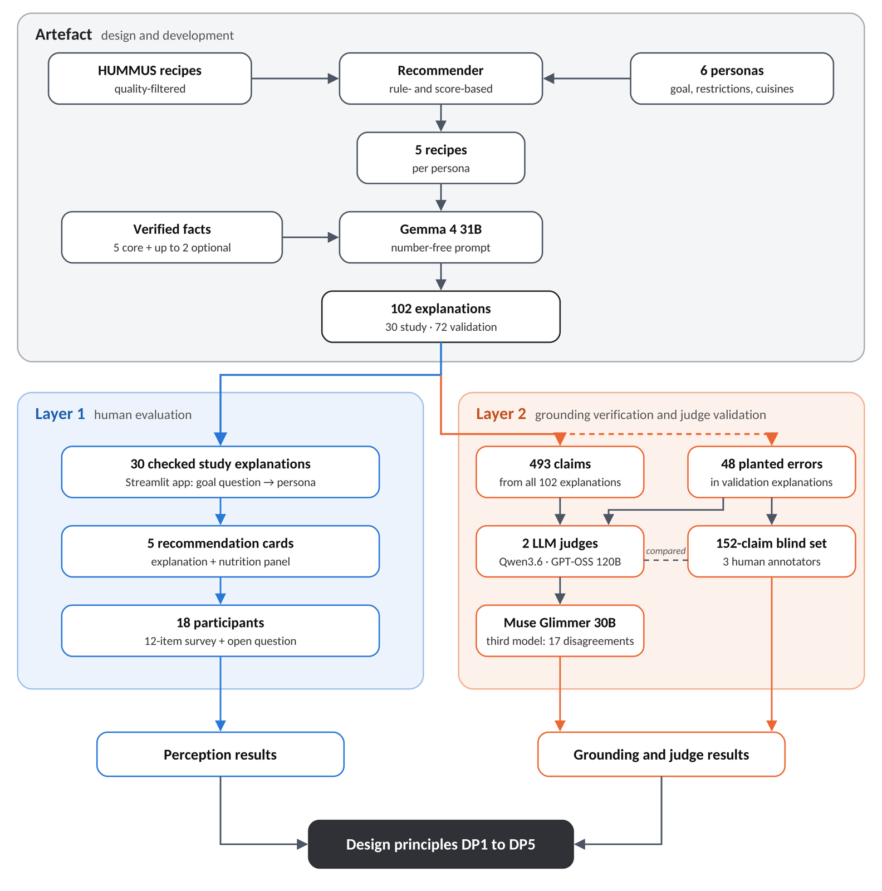
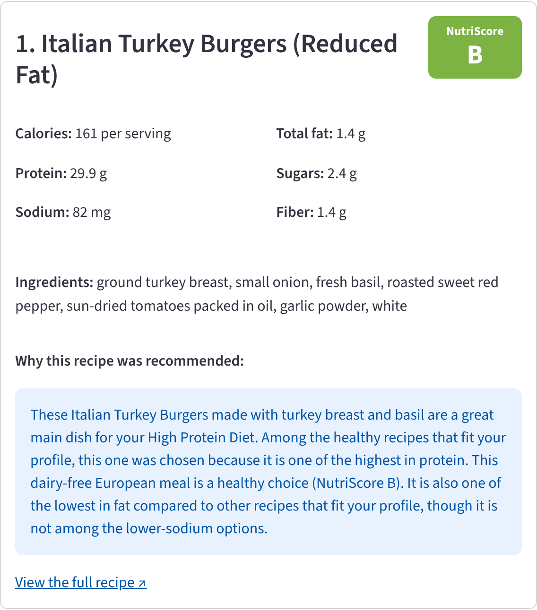

# LLM-Explanation

Code and data for the master's thesis *Grounded LLM explanations for healthy food recommendations: a design science study of user perception and verification*.
The repository holds a recipe recommender whose explanations are written by a large language model (LLM) and then checked, claim by claim, by two other LLMs acting as judges. It also holds the Streamlit app used in the user study. The explanations contain no numbers: exact nutrition values are shown in a separate panel, so every claim in the text can be checked against a single fact.




## Contents

- [Choose how to start](#choose-how-to-start)
- [Path 1: run the study app](#path-1-run-the-study-app)
- [Path 2: read the pipeline](#path-2-read-the-pipeline)
- [Path 3: re-run the pipeline](#path-3-re-run-the-pipeline)
- [Layout](#layout)
- [What is checked where](#what-is-checked-where)
- [Data](#data)
- [Limits](#limits)
- [Troubleshooting](#troubleshooting)
- [Use of generative AI](#use-of-generative-ai)
- [Citing and licence](#citing-and-licence)

## Choose how to start

| Path | You need | You get |
| --- | --- | --- |
| [1. Run the study app](#path-1-run-the-study-app) | Python 3.11 or later | The app exactly as participants used it, with the 30 frozen explanations |
| [2. Read the pipeline](#path-2-read-the-pipeline) | A browser, or Jupyter | The full pipeline in one notebook, mapped to the thesis sections |
| [3. Re-run the pipeline](#path-3-re-run-the-pipeline) | Python 3.11 or later, the HUMMUS recipe file, an OpenAI-compatible LLM endpoint and API keys | New recommendations, explanations and judge verdicts |

## Path 1: run the study app

```bash
git clone https://github.com/dansaari/LLM-Explanation.git
cd LLM-Explanation
python -m venv venv
source venv/bin/activate          # on Windows: venv\Scripts\activate
pip install -r requirements.txt
streamlit run app.py
```

The app opens in your browser. Going through it takes 7 to 10 minutes:

1. **Welcome and consent** (`app.py`)
2. **Profile quiz** (`pages/1_Profile_Quiz.py`): one question about your main health goal, which matches you to the persona with that goal
3. **Recommendations** (`pages/2_Recommendations.py`): the persona's profile and five recipe cards, each with a Nutri-Score badge, nutrition values, ingredients and the explanation
4. **Survey** (`pages/3_Survey.py`): twelve statements rated on a five-point scale, plus one open question
5. **Thank you** (`pages/4_Thank_You.py`): saves the response

<p align="center">
  
</p>

The app reads its explanations from `data/explanations_FROZEN.csv`, so it needs no API keys. It is kept exactly as it was used in the study (September 2026).

Saving responses needs a Google service account. Without one, the app still runs, and the last page reports that the response could not be saved. To enable saving, copy `.streamlit/secrets.toml.example` to `.streamlit/secrets.toml` and fill in your own values.

## Path 2: read the pipeline

`LLM_explanation.ipynb` contains the whole pipeline, from loading the recipes to validating the judges. GitHub displays it directly. The outputs are cleared, so it shows the code and its explanations but not the printed results.

| Section | What it does | 
| --- | --- | --- |
| 1 to 2 | Load and clean the HUMMUS recipes |
| 3 to 6 | Tag mappings, the six personas, the recommender, diversity check |
| 7 | Fact extraction and explanation generation (30 study and 72 validation explanations) |
| 8 | Functional tests of the recommender's hard constraints |
| 9 to 13 | Judge setup, claim-level judging, grounding verdicts, agreement between judges |
| 14 | Adversarial cases with planted errors |
| 15 | Freezing the study set |
| 16 | Annotation workbook, development findings, third model for disagreements |

The 30 explanations participants saw are in `data/explanations_FROZEN.csv`, together with the facts each was generated from (key ingredients, dish type, goal ranking, cuisine match, optional facts) and the nutrition values shown in the app.

## Path 3: re-run the pipeline

**1. Install the packages.**

```bash
pip install -r requirements.txt -r requirements-notebook.txt
```

**2. Add the recipe data.** Download `pp_recipes.csv` from the [HUMMUS data set repository](https://gitlab.com/felix134/connected-recipe-data-set) and place it in `data/`.

**3. Add your API keys.** Create a `.env` file in the repository root. It is excluded from version control.

```
LEHMUS_API_KEY=...
LEHMUS_BASE_URL=...
LEHMUS_API_KEY_2=...      # only for the third model in section 16
```

**4. Point the notebook at your models.** The study used Lehmus AI, an OpenAI-compatible gateway provided by the university that is not publicly accessible. To use another endpoint, set its URL as `LEHMUS_BASE_URL` and change the model IDs here:

| Role | Model in the study | Where to change it |
| --- | --- | --- |
| Generator | Gemma 4 31B | `GENERATION_MODEL`, section 7 |
| Judge 1 | Qwen3.6-35B-A3B | `JUDGE_MODELS['qwen']`, section 9 |
| Judge 2 | GPT-OSS 120B | `JUDGE_MODELS['gpt-oss']`, section 9 |
| Third model for disagreements | Muse-Glimmer-30B-NVFP4 | `THIRD_JUDGE_MODEL`, section 16 |

The judges run at temperature 0. The generator uses the endpoint's default temperature.

**5. Run the notebook from the top.** Each section writes its output to `data/` and the next section reads it from there. Two things to know before you start:

- **Section 15 overwrites `data/explanations_FROZEN.csv`.** That is the file the app shows. Skip the section, or back the file up first, if you want to keep the study set.
- **The comparison with human annotation in section 16** needs an annotation workbook filled in by people, which is not in the repository. Without it, the section runs the third model and skips the comparison.

LLM output varies between runs, so a re-run produces new explanations rather than the study's exact wording.

## Layout

```
.
├── app.py                        Welcome and consent page of the study app
├── pages/
│   ├── 1_Profile_Quiz.py         Health-goal question and persona matching
│   ├── 2_Recommendations.py      Persona profile and five recipe cards
│   ├── 3_Survey.py               Twelve-item survey and open question
│   └── 4_Thank_You.py            Saves the response to Google Sheets
├── data/
│   └── explanations_FROZEN.csv   The 30 explanations shown to participants
├── LLM_explanation.ipynb        The full pipeline, sections 1 to 16
├── docs/images/                  Figures used in this README
├── .streamlit/
│   └── secrets.toml.example      Settings needed to save responses
├── requirements.txt              Packages for the study app
├── requirements-notebook.txt     Additional packages for the notebook
├── CITATION.cff                  Citation metadata
└── LICENSE                       MIT licence
```

New to the project? Read the recipe cards in the app first, then notebook sections 7 (how an explanation is built) and 10 (how a claim is judged).

## What is checked where

| What | Where |
| --- | --- |
| Recommended recipes contain none of the persona's allergens or disliked ingredients | Section 8 |
| Recommended recipes meet the persona's dietary restrictions, sodium limit and minimum calories for a main meal | Section 8 |
| Each claim in an explanation is supported by its fact, and the text contains no nutrient numbers or absolute nutrient levels | Sections 10 to 12 |
| The two judges agree with each other | Section 13 |
| The judges catch errors planted on purpose (48 cases, eight error types) | Section 14 |
| The judges agree with three human annotators; a third model decides the judges' disagreements | Section 16 |

## Data

| Data | In this repository | Notes |
| --- | --- | --- |
| HUMMUS recipes (`pp_recipes.csv`) | No | Download from the [HUMMUS data set repository](https://gitlab.com/felix134/connected-recipe-data-set). Its terms of use apply. |
| Frozen study explanations | Yes | `data/explanations_FROZEN.csv`. Recipe titles and links refer to Food.com. |
| Validation explanations, claims, judge verdicts, adversarial cases | No | Produced by the notebook. |
| Survey responses | No | Individual responses are not published. Aggregate results are in the thesis. |

No personal information was collected in the study. Participants were matched to a persona by their answer to one question, and no participant data was sent to a language model.

## Limits

- **The models were reached through a private gateway.** The model IDs in the notebook only work there, so a re-run needs your own endpoint and models (see Path 3).
- **LLM output is not deterministic.** A re-run will not reproduce the frozen explanations word for word, even with the same models.
- **Grounding is checked against the facts given to the generator, not against reality.** If the HUMMUS data is wrong, a grounded explanation repeats the error.
- **Five claim categories are checked.** The up to two optional facts an explanation may add, such as "quick to prepare", are not judged.
- **Responses are saved only to Google Sheets.** There is no local storage option.
- **The study had 18 participants from a convenience sample.** Its findings are indicative only (see the thesis).

## Troubleshooting

| Symptom | Cause | Fix |
| --- | --- | --- |
| The app shows "No explanations found" | The app was started from another folder | Run `streamlit run app.py` from the repository root |
| The last page says there was a technical issue recording the response | No Google service account is set up | Expected when running locally. Add `.streamlit/secrets.toml` to save responses. |
| `pip` cannot install `pandas==3.0.2` | Python is older than 3.11 | Use Python 3.11 or later |
| `FileNotFoundError: data/pp_recipes.csv` | The HUMMUS recipe file is missing | Download it (see Data) |
| `AssertionError: LEHMUS_API_KEY_2 is not set` | Section 16 needs a second key for the third model | Add it to `.env` and restart the kernel, or skip section 16 |
| A model is not found, or the API returns 404 | The model IDs belong to the study's gateway | Change the model IDs (see Path 3, step 4) |

## Use of generative AI

Generative AI appears in this project in two roles, and they are kept apart here.

**As part of the method.** The artefact itself uses language models: Gemma 4 31B writes the explanations, and Qwen3.6-35B-A3B, GPT-OSS 120B and Muse-Glimmer-30B-NVFP4 check them. This use is the subject of the research and is described in the thesis.

**As a development aid.** Claude (Anthropic), used through claude.ai in 2026, helped write the code and documentation in this repository:

| Part | How AI was used |
| --- | --- |
| Pipeline notebook code (`LLM_explanation.ipynb`) | Claude drafted parts of the code. I reviewed, ran and made changes |
| Study application (`app.py`, `pages/`) | Claude assisted in writing the code. I reviewed, tested and made changes. |
| Notebook text cells, README, `LICENSE`, `CITATION.cff`, requirements files, secrets example | Drafted by Claude and reviewed by me. |
| Study design figure (`docs/images/study_design.png`) | Drawn by Claude from the study design in the thesis. Numbers checked against the results. |

The research design and the decisions behind the artefact are my own and are justified in the thesis. These include the recommender rules and weights, the number-free explanation design, the claim categories, the judge rules and the survey. I checked the AI-drafted code by running it and inspecting its output, using the checks listed in [What is checked where](#what-is-checked-where).

## Citing and licence

If you use this code, please cite the thesis:

> Saari, D. 2026. Grounded LLM explanations for healthy food recommendations: a design science study of user perception and verification. Master's thesis. Oulu University of Applied Sciences.

GitHub also offers a citation from `CITATION.cff` under **Cite this repository** on the repository page.

The recipe data comes from:

> Bölz, F., Nurbakova, D., Calabretto, S., Gerl, A., Brunie, L. & Kosch, H. 2023. HUMMUS: A linked, healthiness-aware, user-centered and argument-enabling recipe data set for recommendation. In Proceedings of the 17th ACM Conference on Recommender Systems (RecSys '23). ACM, Singapore.

The code and the frozen explanations are released under the [MIT Licence](LICENSE). The HUMMUS data set and the Food.com recipes it is built on are not covered by this licence and remain subject to their own terms.
